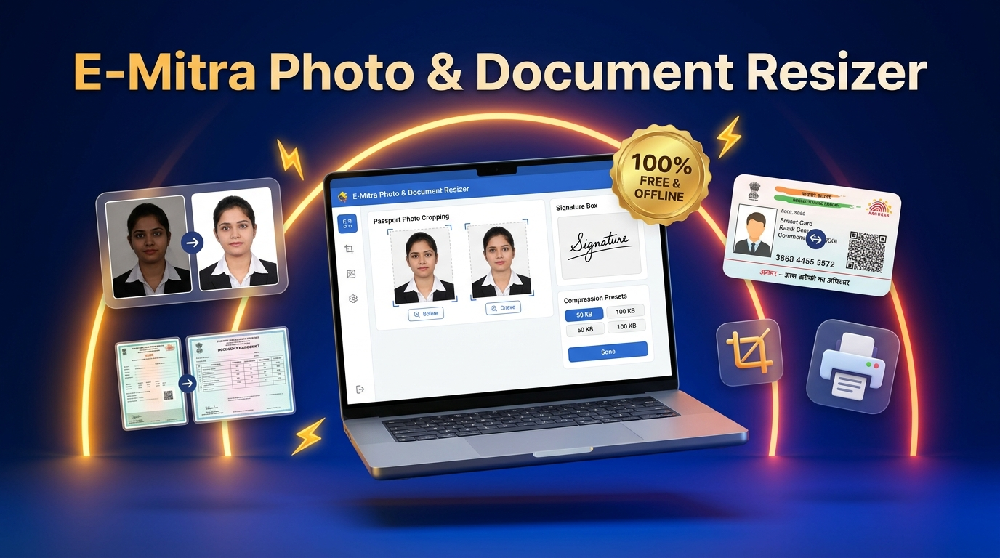
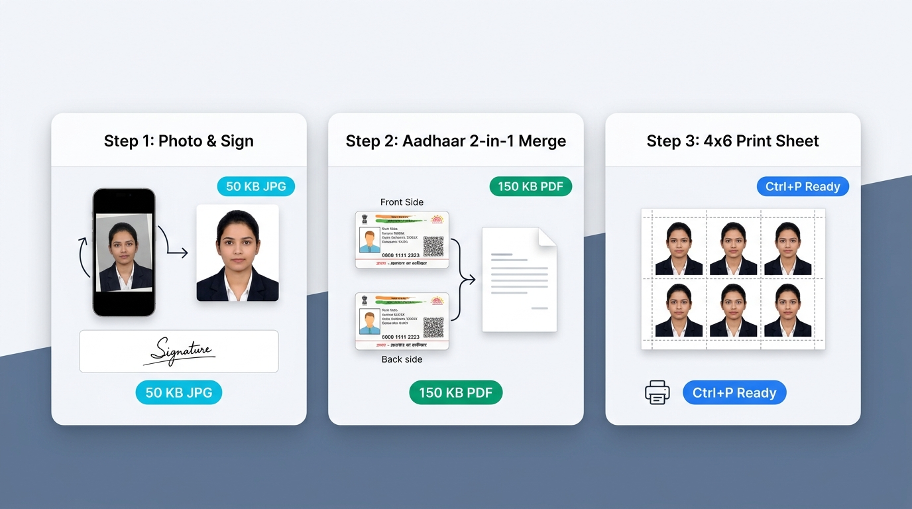

# ई-मित्र व CSC वालों की सबसे बड़ी टेंशन खत्म: 5 सेकंड में फोटो, साइन और आधार कार्ड रीसाइज करने वाला 100% फ्री ऑफलाइन टूल!

> **लेखक नोट / Blog Meta:**
> - **कैटेगरी:** Tech Tools / E-Mitra / CSC Utilities / Government Forms
> - **टारगेट ऑडियंस:** E-Mitra संचालक, CSC VLEs, साइबर कैफे ओनर्स, सरकारी फॉर्म भरने वाले छात्र
> - **प्राइमरी कीवर्ड्स:** emitra photo resizer, csc photo size converter, aadhaar card front back merge offline tool, passport photo 4x6 print sheet, photo sign compressor 50kb
> - **फीचर्ड इमेज (Hero Banner):** फ़ोल्डर में उपलब्ध `blog_hero_banner.jpg` को ब्लॉग के सबसे ऊपर (Featured Image) के रूप में लगाएं।

---


*▲ ई-मित्र व साइबर कैफे संचालकों के लिए ऑल-इन-वन 100% ऑफलाइन टूल — फोटो, साइन, मार्कशीट और आधार मर्ज अब चुटकियों में।*

---

## क्या आपके साथ भी दुकान पर रोज़ यही होता है?

अगर आप राजस्थान में ई-मित्र (E-Mitra) चलाते हैं, CSC सेंटर पर बैठते हैं, या कॉलेज-बाज़ार में साइबर कैफे की दुकान है... तो इस सीन को आप अपनी ज़िंदगी का रोज़ का सिरदर्द मान चुके होंगे:

दुकान के बाहर 4-5 लड़के खड़े हैं। किसी को SSC GD का फॉर्म भरना है, किसी को राजस्थान पुलिस या CET का, तो किसी को NEET का।  
कस्टमर काउंटर पर आकर फोन आगे करता है—  
> *"भैया, मोबाइल से फोटो और साइन खींची है, WhatsApp पर भेज दी है, जल्दी से फॉर्म भर दो!"*

अब आपका असली संघर्ष शुरू होता है:
1. पहले WhatsApp Web खोलो, फोटो डाउनलोड करो (जो डाउनलोड फ़ोल्डर में कचरे की तरह भरती जाती है)।
2. फोटो देखी तो पता चला—कस्टमर ने तिरछी खींची है, बैकग्राउंड में पंखा या दीवार की सीलन दिख रही है, और चेहरा एकदम अंधेरे में है।
3. अब फोटोशॉप खोलो, क्रॉप करो, ब्राइटनेस बढ़ाओ, फिर Paint या ऑनलाइन कंप्रेसर वेबसाइट्स पर जाओ।
4. सरकारी पोर्टल पर अपलोड करने जाओ तो लाल रंग में एरर आ जाता है:  
   **"File size must be between 20 KB to 50 KB only!"** या **"Background must be plain white!"**

इतने में 10 मिनट बर्बाद हो जाते हैं, बाहर खड़े बाकी कस्टमर चिढ़ने लगते हैं, और अगर इंटरनेट धीमा हुआ या ऑनलाइन वेबसाइट पर 50 फालतू ऐड्स आ गए तो दिमाग अलग खराब होता है।

**बस इसी रोज़ के झंझट और सिरदर्द को जड़ से मिटाने के लिए यह टूल तैयार किया गया है:**  
👉 **E-Mitra Photo, Sign & Document Resizer v2.0**

यह कोई भारी-भरकम 2GB का सॉफ्टवेयर नहीं है और न ही इसमें कोई इंटरनेट चाहिए। यह **100% ऑफ़लाइन (बिना इंटरनेट)** काम करता है, पूरी तरह सुरक्षित है और आपके रोज़ के 1 से 2 घंटे बचा देगा।

---


*▲ 3 सबसे बड़े फीचर्स: फोटो-साइन ऑटो रीसाइज, आधार कार्ड 2-इन-1 मर्ज, और 4×6 पासपोर्ट प्रिंट शीट।*

---

## इस टूल में ऐसा क्या खास है जो बाज़ार के किसी दूसरे सॉफ्टवेयर में नहीं?

बाज़ार में कई टूल्स हैं, लेकिन उन्हें बनाने वालों को यह नहीं पता होता कि एक भारतीय साइबर कैफे या ई-मित्र वाले का रोज़ का वर्कफ़्लो क्या होता है। इस टूल को एकदम ज़मीनी ज़रूरतों को ध्यान में रखकर बनाया गया है:

### 1. WhatsApp से सीधी फोटो उठाओ (नो डाउनलोड, नो सेव!)
कस्टमर ने WhatsApp पर फोटो भेजी? आपको उसे कंप्यूटर में सेव करने की ज़रूरत ही नहीं है!
- WhatsApp Web पर फोटो पर राइट-क्लिक करें ➔ **Copy Image** दबाएं।
- इस टूल में आकर सीधे कीबोर्ड से **`Ctrl + V`** दबाएं।
- फोटो तुरंत स्क्रीन पर आ जाएगी! यानी आपके कंप्यूटर का डाउनलोड फ़ोल्डर फालतू फाइलों से नहीं भरेगा।

### 2. उल्टी-सीधी फोटो को 1-क्लिक में सीधा और गोरा करें
- **90° रोटेट (Rotate):** मोबाइल से आई आड़ी-तिरछी फोटो को एक क्लिक में सीधा करें।
- **`+लाइट` (Fair/Tone Fix):** मोबाइल से खींची गई डार्क या परछाई वाली फोटो को एक क्लिक में हल्का गोरा व साफ करें।
- **`+डार्क` (Sign Fix):** नीले या हल्के पेन से किए गए सिग्नेचर को गहरा काला करें ताकि पोर्टल पर रिजेक्ट न हो।
- **⚪ सफेद या 🔵 नीला पर्दा (Background Fix):** पीछे कोई भी दीवार हो, एक क्लिक में पासपोर्ट साइज वाला एकदम साफ सफेद या स्काई-ब्लू बैकग्राउंड लगाएं।

### 3. फिक्स सरकारी साइज (20 KB से 50 KB की परफेक्ट गारंटी)
पोर्टल चाहे SSC का हो, UPSC का हो, RPSC का या NEET का—बस बॉक्स में लिखिए **50 KB** या **20 KB**।  
सॉफ्टवेयर फोटो को सरकारी मानक अनुपात (**3.5 × 4.5 सेमी**) में लॉक करके ठीक उसी साइज में JPG निकाल कर देगा। कभी भी "Size Exceeded" का एरर नहीं आएगा।

### 4. फोटो पर नाम व तारीख (DOP) डालना अब 2 सेकंड का काम
आजकल कई सरकारी भर्तियों (जैसे SSC, व्यापम, आदि) में फोटो के नीचे उम्मीदवार का नाम और फोटो खिंचवाने की तारीख (Date of Photograph) मांगते हैं।  
पहले इसके लिए फोटोशॉप में टेक्स्ट लेयर बनानी पड़ती थी। यहाँ सिर्फ एक टिक मार्क लगाएं, नाम और तारीख टाइप करें—सॉफ्टवेयर अपने आप फोटो के नीचे सफेद पट्टी पर बोल्ड अक्षरों में नाम और DOP सेट कर देगा।

### 5. आधार कार्ड Front + Back एक ही पेज पर (Aadhaar 2-in-1 Merge)
यह हर ई-मित्र वाले का सबसे पसंदीदा फीचर है!  
कस्टमर आधार कार्ड या वोटर आईडी के आगे और पीछे की दो अलग-अलग फोटो देता है। इस टूल के **"📄 दस्तावेज़ (A4)"** टैब में जाइए:
- फ्रंट फोटो और बैक फोटो सिलेक्ट कीजिए।
- टूल दोनों को एक सुंदर A4 पेज पर ऊपर-नीचे जोड़ देगा।
- **100 KB, 150 KB या 200 KB** का बटन दबाइए और सीधे सरकारी पोर्टल के लिए **PDF या JPG** में सेव कर लीजिए! न फोटोशॉप का झंझट, न वर्ड फाइल का।

### 6. तुरंत 4×6 पासपोर्ट फोटो शीट निकालें (Instant Photo Print)
अगर कोई कस्टमर पासपोर्ट फोटो निकलवाने आया है:
- फोटो लोड करें और **"🖨️ प्रिंट शीट"** टैब पर क्लिक करें।
- अपनी पसंद चुनें: **4×6 इंच शीट पर 6 फोटो या 8 फोटो** (या A4 पर 12/24 फोटो)।
- कैंची से काटने के लिए इसमें ऑटोमैटिक पतला कटिंग बॉर्डर आता है।
- कीबोर्ड से दबाएं **`Ctrl + P`** और सीधे 300 DPI में फोटो प्रिंटर से प्रिंट निकाल दें!

---

## ⚡ कीबोर्ड शॉर्टकट्स: जो आपकी स्पीड को 10 गुना तेज बना देंगे

दुकान पर जब भीड़ होती है, तब माउस इधर-उधर घुमाने का वक्त नहीं होता। इसीलिए इसमें सुपरफास्ट शॉर्टकट्स दिए गए हैं:

| शॉर्टकट | क्या काम करता है? |
| :--- | :--- |
| **`Ctrl + V`** | WhatsApp से कॉपी की हुई फोटो या साइन तुरंत पेस्ट करें |
| **`Ctrl + S`** | तैयार फोटो, साइन या PDF को तुरंत सेव (Save As) करें |
| **`Ctrl + P`** | 4×6 पासपोर्ट फोटो शीट का डायरेक्ट प्रिंट निकालें |
| **`Del` / `Esc`** | स्क्रीन साफ करें और अगले कस्टमर के लिए तैयार हों |

---

## 🔒 100% सुरक्षित और 100% ऑफ़लाइन (No Internet Needed)

ऑनलाइन टूल्स में दो बहुत बड़े खतरे होते हैं:
1. **इंटरनेट कटने पर काम ठप:** गांव या कस्बे में अगर नेट धीमा है तो वेबसाइट घूमती रहती है।
2. **डेटा चोरी का डर:** कस्टमर के आधार कार्ड, मार्कशीट और फोटो किसी अनजान विदेशी सर्वर पर अपलोड होते हैं, जो प्राइवेसी के लिए बहुत बड़ा खतरा है।

**यह टूल पूरी तरह आपके अपने कंप्यूटर पर चलता है।**  
- इसे चलाने के लिए इंटरनेट की 1 KB भी ज़रूरत नहीं है।  
- कस्टमर का कोई भी दस्तावेज़ या फोटो इंटरनेट पर नहीं जाता। सब कुछ आपके पीसी में सुरक्षित रहता है।

---

## 💻 डाउनलोड और इंस्टॉलेशन कैसे करें? (बहुत आसान)

इस टूल को इंस्टॉल करना उतना ही आसान है जितना कोई साधारण गेम या ऐप इंस्टॉल करना:

### स्टेप 1: सेटअप फाइल डाउनलोड करें
नीचे दिए गए आधिकारिक डाउनलोड बटन पर क्लिक करके विंडोज़ सेटअप फाइल डाउनलोड करें:

```html
<!-- Blog Download Button Code -->
<div style="text-align: center; margin: 30px 0;">
  <a href="https://github.com/YOUR_USERNAME/Emitra-Photo-Resizer/releases/latest/download/Setup_Emitra_Photo_Resizer_v2.0.exe" 
     style="background: linear-gradient(135deg, #2563eb, #1d4ed8); color: #ffffff; padding: 16px 32px; font-size: 18px; font-weight: bold; text-decoration: none; border-radius: 8px; box-shadow: 0 4px 14px rgba(37,99,235,0.4); display: inline-block;">
    ⚡ Download E-Mitra Photo Resizer v2.0 (Windows Setup)
  </a>
  <p style="font-size: 13px; color: #64748b; margin-top: 8px;">
    साइज़: ~70 MB • वर्शन: v2.0 • 100% वायरस फ्री • विंडोज़ 10 / 11 सपोर्टेड
  </p>
</div>
```

*(नोट: ऊपर दिए गए लिंक में `YOUR_USERNAME` की जगह अपना GitHub यूजरनेम डालें)*

### स्टेप 2: सेटअप चलाएं
- डाउनलोड की गई फाइल **`Setup_Emitra_Photo_Resizer_v2.0.exe`** पर डबल क्लिक करें।
- "Next" और "Install" पर क्लिक करें।
- 10 सेकंड में आपके डेस्कटॉप पर **"फोटो & साइन रीसाइज़र"** का सुंदर आइकन बनकर आ जाएगा।

### स्टेप 3: काम शुरू करें!
- डेस्कटॉप वाले आइकन पर क्लिक करें। टूल तुरंत खुल जाएगा।
- अब किसी भी फोटो को WhatsApp से पेस्ट करें या ड्रैग करके छोड़ें, और अपना काम 5 सेकंड में पूरा करें!

---

## ❓ अक्सर पूछे जाने वाले सवाल (FAQs)

**Q1. क्या यह टूल हमेशा के लिए फ्री है?**  
**उत्तर:** हाँ, यह टूल हमारे ई-मित्र, CSC और साइबर कैफे संचालक भाइयों की मदद के लिए बिल्कुल फ्री है। इसका कोई सब्सक्रिप्शन या हिडन चार्ज नहीं है।

**Q2. क्या इसके लिए फोटोशॉप का आना ज़रूरी है?**  
**उत्तर:** बिल्कुल नहीं! इसे इस तरह डिजाइन किया गया है कि कोई 10वीं पास लड़का भी पहले दिन ही 5 सेकंड में फोटो और आधार कार्ड रीसाइज कर सकता है।

**Q3. क्या यह विंडोज़ 7 या 8 में चलेगा?**  
**उत्तर:** यह विंडोज़ 10 और विंडोज़ 11 में सबसे बेहतरीन चलता है। अगर आपके पास 64-बिट विंडोज़ है तो यह बहुत स्मूद काम करेगा।

**Q4. क्या NEET या डाक विभाग के लिए अंगूठे का निशान (Thumb Impression) भी सेट कर सकते हैं?**  
**उत्तर:** जी हाँ! इसमें खास तौर पर **"👆 अंगूठे का निशान (Thumb / LTI)"** मोड दिया गया है, जो स्याही को गहरा करके बैकग्राउंड को एकदम दूध जैसा सफेद बना देता है, जिससे फॉर्म कभी रिजेक्ट नहीं होता।

---

## 📢 अपने ई-मित्र और CSC भाइयों के साथ शेयर करें!

अगर आप किसी ई-मित्र, CSC या कंप्यूटर ऑपरेटर के WhatsApp या Telegram ग्रुप में जुड़े हैं, तो इस पोस्ट को अपने बाकी साथियों के साथ **जरूर शेयर करें**। आपका एक शेयर किसी भाई के रोज़ाना के 2 घंटे और सिरदर्द बचा सकता है!

यदि आपके मन में कोई सुझाव या सवाल है, तो नीचे कमेंट बॉक्स में जरूर बताएं। हम आने वाले अपडेट में आपके सुझावों को शामिल करेंगे।

---
*(पोस्ट अच्छी लगी हो तो बुकमार्क कर लें और अपने दोस्तों को भी बताएं!)*
